# DitherCraft — Comprehensive Engineering Roadmap & Stability Architecture

**Document Version:** 4.0.0  
**Project:** DitherCraft — Studio-Grade Retro Graphics Workstation in Pure Rust  
**Last Updated:** October 12, 2026  
**Status:** Phases 1–13 Delivered (`v0.9.8`); Phases 14–18 Active Engineering Evolution (`v1.1.0+`)  

---

## Strategic Vision

This roadmap establishes the strategic engineering vision for **DitherCraft** to evolve from its core algorithm baseline into a production-grade, zero-crash, studio-grade retro graphics workstation, DSP engine, spatial masking and selection suite, and universal media fabrication pipeline in Pure Rust.

```mermaid
flowchart TD
    subgraph CoreFoundations["Foundation & Color Science (v0.9.0)"]
        S1["Phase 1: Engine Stability & Memory Safety"] --> S2["Phase 2: Color Science & Visual Fidelity"]
        S2 --> S3["Phase 3: Studio UX & Canvas Ergonomics"]
        S3 --> S4["Phase 4: Vector Shaper & CNC Plotter Toolpaths"]
        S4 --> S5["Phase 5: GPU Compute & Realtime WGSL Acceleration"]
        S5 --> S6["Phase 6: Multimedia, Audio-DSP & Video Containers"]
    end

    subgraph CoreMilestones["High-Performance Workstation (v1.0.0)"]
        S6 --> S7["Phase 7: Ultra-Performance Engine & SIMD Kernels"]
        S7 --> S8["Phase 8: Studio-Grade Professional UI/UX & Workstation"]
        S8 --> S9["Phase 9: Creative DSP, Generative Masks & Production"]
        S9 --> S10["Phase 10: Advanced Printmaking & Physical Fabrication Studio"]
        S10 --> S11["Phase 11: Non-Linear Video & Motion Graphics Suite"]
        S11 --> S12["Phase 12: Generative DSP & Procedural Texture Synthesis"]
        S12 --> S13["Phase 13: WebAssembly Studio & Zero-Dependency Plugin API"]
    end

    subgraph StudioWorkstationEvolution["Next-Gen Workstation Evolution (v1.1.0+)"]
        S13 --> S14["Phase 14: Studio-Grade UI/UX Architecture & Ergonomics"]
        S14 --> S15["Phase 15: Non-Destructive Spatial Masking & Dual-Algorithm Blending"]
        S15 --> S16["Phase 16: Interactive Selection Tools & Vector Marquee System"]
        S16 --> S17["Phase 17: Enterprise Media Ingestion & Robust File Pipeline"]
        S17 --> S18["Phase 18: Project Bundles, Batch Automation Studio & Ecosystem"]
    end
```

---

## Phase 1: Engine Stability, Concurrency & Memory Safety (P0 — Completed)

Focus: Eliminate all potential panic paths, resource exhaustion risks, and GUI thread deadlocks under extreme input workloads.

### 1.1 Concurrency & GPU Texture Lifecycle
- [x] **In-Place Texture Streaming (`tex.set`)**: Prevent texture deallocation panics during concurrent viewport drawing by mutating GPU texture handles in-place via `ImageDelta::full`.
- [x] **Stale Render Job Cancellation**: Implement atomic generation tokens (`Arc<AtomicU64>`) on render requests so worker threads abort abandoned background jobs immediately when sliders move, preventing thread pool saturation and latency queues.
- [x] **Frame Rate Throttling & Power Capping**: Adaptive idle detection (drop UI refresh from 60 FPS to 0 FPS when image and controls are static; trigger redraws purely via input events and worker completion).

### 1.2 Memory Footprint & Large Image Handling
- [x] **Bounded Image Cache**: Prevent Out-Of-Memory (OOM) failures when importing large animated GIFs by enforcing allocation ceilings (300 frame cap, 16 MP limit).
- [x] **Progressive Downsampled Preview**: Generate a fast $512\times 512$ thumbnail pass during active slider scrubbing ($< 2\text{ms}$ latency), switching to full-resolution rendering upon mouse release.
- [x] **Safe Codec Decoders**: Implement strict allocation limits (`max_alloc`) on `image` decoders to prevent decompression bomb exploits on malformed headers.

### 1.3 Property Testing, Fuzzing & Diagnostic Logging
- [x] **Algorithm Fuzzing Suite**: Setup `proptest` targets verifying zero panics across all 63 algorithms on:
  - Empty image buffers ($0\times 0$, $1\times 1$).
  - Ultra-wide aspect ratios ($32768\times 1$).
  - Extreme dynamic ranges and single-color images (all `#000000`, all `#FFFFFF`).
  - Palettes with 1 color, duplicate colors, and extreme 256-color arrays.
- [x] **Deterministic Golden Testing**: Automated visual regression testing comparing output hashes (FNV-1a 64-bit) against fixed golden reference values across Linux, macOS, and Windows.
- [x] **Structured Telemetry & Stage Breakdown**: Record rendering latency per stage (Kernel Dither $\to$ Post-Effects Stack $\to$ Histogram Analysis $\to$ Total Elapsed) with live interactive Telemetry HUD and status bar tooltip inspector.

---

## Phase 2: Professional Color Science & Visual Fidelity (P1 — Completed)

Focus: Solve academic color artifacts, dark haloing, and midtone saturation loss common in naive RGB dithering.

### 2.1 Gamma-Correct Linear Dithering
- [x] **Linear sRGB Blending**: Transfer functions `to_linear_f32` and `from_linear_f32` with gamma-correct perceptual color mapping.
  $$\text{linear} = \begin{cases} \frac{C}{12.92} & C \le 0.04045 \\ \left(\frac{C + 0.055}{1.055}\right)^{2.4} & C > 0.04045 \end{cases}$$

### 2.2 Modern Perceptual Color Spaces
- [x] **OKLab & Oklch Color Difference**: Integrate the Björn Ottosson OKLab perceptual space into `ColorMetric`:
  - Eliminates the blue-to-purple hue shifts found in CIELAB 1976.
  - Enables true perceptual lightness ($L$), chroma ($C$), and hue ($h$) independent thresholding.
- [x] **CIEDE2000 ($\Delta E_{00}$)**: Implement the complete ISO/CIE standard color difference equation with hue rotation terms ($R_T$) and parametric compensation factors ($k_L, k_C, k_H$).

### 2.3 Palette Diagnostics & Statistical Analysis
- [x] **Color Histogram & Utilization Meter**: Real-time bar chart showing exact pixel percentage allocated to each palette swatch in the active frame.
- [x] **Underutilized Swatch Pruning**: Auto-detect swatches receiving $< 0.1\%$ allocation with a single-click "Prune Dead Colors" optimizer.
- [x] **Live Interactive Swatch Editing**: Interactive UI allowing users to customize swatch colors with live color pickers, lock key anchor colors, and dynamically add/remove swatches directly in the palette drawer.
- [x] **Multi-Format Palette Exporter & ACT Support**: Export and import active palettes across `.gpl` (GIMP), `.hex`, `.pal` (JASC), `.act` (Color Table), and `.json` in Desktop UI and CLI.
- [x] **Accelerated Exact-Match Swatch Lookup**: Sub-microsecond fast path for quantized pixel histogram categorization bypassing expensive color space distance calculations.

---

## Phase 3: Studio Workflow, Canvas Ergonomics & Utility (P1 — Completed)

Focus: Elevate daily user workflow to parity with professional design workstations.

### 3.1 Advanced Interactive Canvas
- [x] **Infinite Pan & Smooth Zoom**:
  - Pan via Middle-Mouse-Drag, Right-Drag, or `Space + Left-Drag`.
  - Continuous zoom centered on cursor from $5\%$ to $3200\%$ with integer pixel-snap toggle.
- [x] **Pixel Grid Overlay**: Crisp 1-pixel hairline grid rendered automatically at zoom levels $\ge 800\%$ for precision subpixel inspection.
- [x] **Floating Viewport HUD**: Quick-access controls for 1:1 scale, Fit-to-screen, zoom percentage, and grid toggling.
- [x] **Multi-Mode Split View**:
  - Horizontal & Vertical split comparison slider.
  - Checkerboard A/B comparison.
  - Difference Heatmap mode highlighting exact delta pixels between source and dithered output.

### 3.2 Studio History, Presets & Batch Processing
- [x] **Infinite Undo / Redo (`Ctrl+Z` / `Ctrl+Shift+Z`)**: Command-pattern undo stack capturing algorithm changes, palette selections, post-effect parameters, and crop adjustments.
- [x] **Preset Management System (`.dcpreset`)**:
  - One-click export and import of complete workstation configurations (algorithm + custom palette + CRT parameters + temporal noise settings).
  - Bundled user preset library with categories: *Game Boy Vintage*, *Cyberpunk Neon*, *1980s VHS*, *Thermal Camera*, *Newspaper Halftone*.
- [x] **Desktop Batch Processing Queue**:
  - Dedicated Batch Studio panel accepting multi-file folder drops and directories.
  - Parallel background worker dispatch with live progress telemetry.
- [x] **Workstation Ergonomics**:
  - Drag-and-drop file ingestion across all supported image and video formats.
  - Recent files tracking with "Open Recent" submenu.
  - Suggested smart filename generation (`{stem}_{algo}_{palette}.{ext}`).
  - Downstream effects randomizer ("🎲 Shuffle").

---

## Phase 4: Vector Shaper & CNC / Plotter Toolpaths (P2 — Completed)

Focus: Transform DitherCraft into the premier vector pre-processor for pen plotters, laser cutters, vinyl cutting, and screen printing.

### 4.1 Contour Simplification & Curve Fitting
- [x] **Ramer-Douglas-Peucker (RDP) Simplification**: Reduce collinear SVG line points by $70\text{--}90\%$ while preserving sharp corners, featuring a real-time tolerance slider ($\epsilon$).
- [x] **Visvalingam-Whyatt Area-Based Simplification**: Alternative curve simplifier preserving subtle organic contours without creating angular artifacts.
- [x] **Piecewise Cubic Bézier Fitting**: Fit piecewise cubic Bézier curves (`<path d="M... C...">`) over pixel stairsteps for ultra-smooth physical pen plotter strokes.

### 4.2 Multi-Color Separations & G-Code Toolpaths
- [x] **Color Separation Layers (SVG)**: Output multi-layer SVGs with one `<g id="color-name">` per palette swatch, tailored for multi-pen AxiDraw plotters and multi-screen silkscreen printing.
- [x] **Direct G-Code Exporter**:
  - Generate clean G-code (`G00` pen up / travel, `G01` pen down / cut) with configurable feed rates, spindle speed / laser power, and pen-lift delays.
  - **Traveling Salesperson (TSP) Toolpath Optimization**: Nearest-neighbor path sorting minimizing rapid pen-up travel distance by up to $60\%$.

---

## Phase 5: Hardware-Accelerated GPU Compute (WGSL) (P2 — In Progress)

Focus: Sub-millisecond real-time processing for 4K and 8K ultra-high-resolution canvases.

### 5.1 WGPU Compute Pipeline
- [x] **Point-Wise Compute Kernels (WGSL)**:
  - Port ordered dithering (Bayer $8\times 8$ matrix) to parallel GPU compute shaders (`BAYER_ORDERED_COMPUTE_WGSL`).
  - Port rotated screen halftones and frequency modulation masks to compute passes (`HALFTONE_SCREEN_COMPUTE_WGSL`).
- [x] **Real-Time CRT & Post-Process Fragment Shader**: Move bloom glow, barrel lens curvature, scanlines, and chromatic aberration from CPU loops to a unified GPU post-processing compute pass (`CRT_POSTPROCESS_WGSL`).
- [ ] **Zero-Copy Surface Rendering**: Bind compute shader storage buffers directly to egui texture sampler views, bypassing CPU host readback.

---

## Phase 6: Multimedia, Audio-DSP & Video Containers (P3 — Completed)

Focus: Dynamic multimedia creation, video container processing, and music-synchronized graphics.

### 6.1 Native Video Container Demuxing & Modern Animated Exporters
- [x] **Pure-Rust Container Ingestion (MP4 & WebM)**:
  - Implemented pure-Rust ISO-BMFF MP4 demuxer (`Mp4Demuxer`) in `crates/dither-core/src/video.rs` parsing video tracks, nominal FPS, and sample tables without system FFmpeg dependencies.
  - Implemented pure-Rust EBML/WebM demuxer (`WebmDemuxer`) in `crates/dither-core/src/video.rs` parsing tracks, VP8/VP9/AV1 codecs, and Cluster SimpleBlocks.
- [x] **APNG & Animated WebP Exporters**:
  - Output modern, high-efficiency animated formats with full 24-bit color depth alongside legacy GIF via `png` chunk assembly in Desktop UI and CLI.
  - Implemented pure-Rust Animated WebP container muxer (`WebpAnimationMuxer`) assembling `VP8X`, `ANIM`, and `ANMF` chunks with lossless compression in Desktop UI and CLI.

### 6.2 Audio-Reactive DSP Dithering
- [x] **Audio Spectrum Analyzer**: Ingest `.wav` audio tracks with pure-Rust RIFF WAV decoder, perform multi-band frequency analysis (bass, mid, treble, RMS) to drive:
  - Dither threshold modulation (pulsing to bass kicks).
  - CRT scanline jitter (reacting to snare transients).
  - Glitch core displacement (triggering on sub-bass drops).
- [x] **Synchronized Audio Slicing & Export**: Export synchronized WAV audio slices (`AudioTrack::export_wav_slice`) matched to animation frame count and target FPS in Desktop UI and CLI.

---

## Phase 7: Ultra-Performance Engine & SIMD Kernels (P1 — Target v1.0.0)

Focus: Push pixel-throughput past 1 Gigapixel/sec on modern multi-core x86_64 and AArch64 hardware.

### 7.1 Portable SIMD Color Distance Acceleration
- [x] **AVX2 / NEON Batch Quantization** (DELIVERED in `v0.9.8`):
  - Evaluates 8 pixels simultaneously against active palette color swatches in parallel using packed SIMD vector lanes (`quantize_batch_8`, `quantize_buffer_simd`).
  - Vectorized Euclidean RGB and OKLab Euclidean distances (`L`, `a`, `b` differences) without per-pixel branch divergence, enabling auto-vectorization into AVX2 / NEON.

### 7.2 Tile-Based Parallel Wavefront Error Diffusion
- [x] **Diagonal Wavefront Multi-Threading** (DELIVERED in `v0.9.8`):
  - Solves the inherently serial row-by-row dependency of error diffusion (Floyd-Steinberg, Atkinson, Stucki, JJN).
  - Partitions images into diagonal wavefront bands or stepped tiles, dispatching concurrent Rayon worker threads along independent wavefront lines ($x + y = k$) with inter-tile boundary error propagation (`diffuse_wavefront_parallel`, `ParallelWavefrontFloydSteinberg`).
  - Eliminates single-core bottleneck for high-resolution images.

### 7.3 Cache-Oblivious Space-Filling Curves (Hilbert & Morton / Z-Order)
- [x] **Fractal Space-Filling Traversal**:
  - Implemented recursive Hilbert space-filling curve generator (`HilbertCurve`) in `crates/dither-core/src/buffer.rs` with exact bidirectional bijective mapping (`d2xy` and `xy2d`).
  - Added `HilbertCurve::generate_order(width, height)` enabling fractal scanline traversal that maintains spatial locality and eliminates directional worming artifacts.

### 7.4 Zero-Allocation Ring Buffers & In-Place Frame Pools
- [x] **Reusable ImageBuffer Arena & LUT Tone Levels**:
  - Implemented `ImageBufferPool` using pre-allocated bounded memory slabs for zero-allocation recycling during animation scrubbing and batch processing.
  - Implemented `ImageBuffer::adjust_levels(black_point, white_point, gamma)` with a 256-element precomputed lookup table for instantaneous pre-dither tone mapping.

---

## Phase 8: Studio-Grade Professional UI/UX & Creative Workstation (P1 — Target v1.0.0)

Focus: Modernize the desktop workstation into an intuitive, visually polished, studio-grade creative tool matching premier graphics software.

### 8.1 Interactive Tone Curves & Levels Histogram Editor
- [x] **Dual-Tone Curves Panel** (DELIVERED in `v0.9.8`):
  - Interactive cubic spline curve editor for Master Luminance, Red, Green, and Blue channels.
  - Real-time overlay of pre-dither input histogram and post-curve output distribution.
  - Black point, White point, and Midtone Gamma ($0.1\text{--}3.0$) draggable pins with numerical readouts.

### 8.2 Draggable & Reorderable Downstream Effects Stack
- [x] **Node/Layer Effect Manager** (DELIVERED in `v0.9.8`):
  - Interactive visual effect stack where users can drag, reorder (⬆/⬇), duplicate, and toggle post-effects with instant preview feedback (`EffectStack`, `EffectNode`, `EffectKind`).
  - Per-effect blend modes (Normal, Multiply, Screen, Overlay, Color Dodge, Difference).
  - Individual effect bypass toggles, duplicate layer buttons, and opacity sliders ($0\%\text{--}100\%$).

### 8.3 Floating Precision Magnifier Loupe & Subpixel Inspector
- [x] **Interactive Loupe Tool**:
  - Floating $9 \times 9$ subpixel magnifying HUD tethered to the cursor with real-time inspection showing coordinates `(X, Y)`, `RGB(r, g, b)`, and `#RRGGBB` hex code.
  - Toggled with single keypress (`L`), top View menu, and floating Viewport HUD.

### 8.4 Color Harmony Generator & Interactive OKLCH Color Wheel
- [x] **Intelligent Palette Harmonizer**:
  - Interactive circular OKLCH / HSV color wheel and dedicated modal dialog in the Palette Drawer.
  - One-click harmony generation based on classical color theory: Complementary, Triadic, Analogous, Split-Complementary, Tetradic, and Monochromatic harmonies.
  - Dynamic palette quantization remapping source harmonies into retro bit-depth constraints (1-bit, 2-bit, 4-bit, 8-bit).
  - Headless CLI integration via `generate-harmony` subcommand exporting `.gpl`, `.json`, and `.hex`.

### 8.5 Instant A/B Preset Snapshot Comparator
- [x] **Quick Snapshot Slots (Slots A/B/C/D)**:
  - Instantaneous snapshot capture and recall with memory slots `[A]`, `[B]`, `[C]`, `[D]`.
  - Keyboard accelerators `F5`–`F8` (recall) and `Shift + F5`–`F8` (store), plus one-click status bar buttons and Presets menu items for rapid A/B visual evaluation.

### 8.6 Professional Workspace Ergonomics & Keyboard HUD
- [x] **Keyboard Shortcut Cheatsheet Modal**:
  - Dedicated modal dialog (`?` / `F1`) summarizing all viewport navigation controls, zoom shortcuts, A/B snapshot slots, and loupe hotkeys.
- [ ] **Dockable / Collapsible Studio Layouts**:
  - Left panel: Tool selection, color curves, palette drawer.
  - Right panel: Effect stack, algorithm parameters, temporal noise, and export options.
  - Bottom panel: Video timeline, audio waveform, and playback transport.

### 8.7 Visual Preset Browser & Live Thumbnail Matrix
- [x] **Simultaneous Multi-Preset Preview Grid** (DELIVERED in `v0.9.10`):
  - Dedicated visual browser modal rendering all presets in responsive cards with search filtering and category tabs.
  - Live color swatch chips, effect badges (`[CRT]`, `[Glow]`, `[LUT]`, `[Glitch]`), and one-click application.
  - Allows instantaneous visual comparison of contrasting aesthetics without sequential menu navigation.

### 8.8 Canvas Viewport Rulers, Draggable Guides & Aspect Grids
- [x] **Studio Alignment & Framing Overlays** (DELIVERED in `v0.9.10`):
  - Real-time pixel rulers flanking top and left canvas edges with subpixel mouse reticle ticks and coordinate labels.
  - Interactive alignment guide lines with center guide generation and clearing.
  - Aspect ratio framing guides for retro target displays: Game Boy (10:9 / 160×144), NES/SNES (8:7 / 256×224), CGA/EGA (4:3 / 320×200), CRT Arcade (3:4 / 224×288), and Modern 16:9 / 1:1.

### 8.9 Non-Destructive Canvas Crop, Rotate, Flip & Integer Scaling
- [x] **Canvas Geometry Workshop** (DELIVERED in `v0.9.8`):
  - Interactive crop modal dialog with custom pixel region selection and aspect constraints.
  - Lossless 90°/180°/270° rotation and horizontal/vertical flip operations (`rotate_90_cw`, `rotate_180`, `rotate_270_cw`, `flip_horizontal`, `flip_vertical`).
  - Integer scale multiplier presets ($1\times, 2\times, 4\times, 8\times$) with nearest-neighbor crisp pixel scaling for retro asset export.
  - Viewport HUD and Transform menu shortcuts for instantaneous manipulation.

### 8.10 Color Vision Deficiency (CVD) Real-Time Accessibility Filters
- [x] **Perceptual Accessibility Simulation** (DELIVERED in `v0.9.8`):
  - Real-time viewport simulation modes based on Machado et al. (2009) and Brettel et al. (1997) algorithms (`apply_cvd_simulation`, `CvdMode`):
    - *Protanopia* (Red-blindness, L-cone deficiency)
    - *Deuteranopia* (Green-blindness, M-cone deficiency)
    - *Tritanopia* (Blue-yellow deficiency, S-cone deficiency)
    - *Achromatopsia* (Complete monochromacy)
  - Allows printmakers, game developers, and UI designers to audit high-contrast readability and color differentiation before physical fabrication.

---

## Phase 9: Creative DSP, Generative Masks & Production (P2 — Target v1.1.0)

Focus: Expand creative versatility for artists, printmakers, and multimedia designers.

### 9.1 Selective Dithering & Spatial Alpha Masking
- [x] **Region-Selective Processing**:
  - `TonalBandDither`: Hermite smoothstep-feathered algorithm split across Shadows, Midtones, and Highlights with live GUI controls and CLI subcommand `tonal-split`.
  - `AlphaMaskDither`: Per-pixel alpha blending between arbitrary algorithms with luminance/alpha gradient masking.
  - Zero heap allocation in hot loop blending.

### 9.2 Custom Threshold Matrix Designer
- [x] **Interactive Matrix Workshop**:
  - `CustomMatrixDither` engine supporting dynamic $N \times M$ matrix thresholds ($2\times 2$ up to $16\times 16$).
  - Full JSON import and export for sharing custom ordered dithering patterns, stamps, and crosshatching matrices.
  - Interactive GUI panel with preset buttons (Spiral 4x4, Checker 2x2, Bayer 4x4 Variant) and dynamic file picker integration.
  - Direct factory instantiation via `create_algorithm("custom")`.

### 9.3 3D LUT (Look-Up Table) Vintage Film Emulation
- [x] **Pure-Rust 3D LUT Engine**:
  - Zero-dependency parser and trilinear interpolator for standard `.cube` 3D Color Look-Up Tables with parallel Rayon processing.
  - Bundled vintage film profiles: Early Technicolor 2-Strip, 1970s Vintage Warm, Amber Phosphor, Cyber Matrix, and Bleach Bypass.
  - Dynamic integration in GUI Effects stack with custom `.cube` file loader and preset persistence.
  - CLI subcommand `apply-lut` for batch grading image pipelines.

### 9.4 Production Batch Automation & Export Queue
- [ ] **Batch Production Studio Upgrades**:
  - Multi-target simultaneous export: save PNG, WebP, SVG, and WAV in a single batch pass.
  - Customizable naming templates: `{stem}_{algo}_{palette}_{w}x{h}_{timestamp}`.
  - Automated watermark placement and EXIF/metadata management for web and archive distribution.

---

## Phase 10: Advanced Printmaking & Physical Fabrication Studio (P1 — Target v1.1.0)

Focus: Expand DitherCraft into the industry-standard vector and separation engine for risograph printing, screen printing, pen plotters, and CNC fabrication.

### 10.1 CMYK Rosette Dot-Screen Angle Separations
- [x] **Traditional Offset Printing Screens**:
  - Implement true angular dot-screen halftoning with standard offset rosette angles: Cyan (15°), Magenta (75°), Yellow (0°), and Black (45°) to prevent moiré interference.
  - Configurable screen frequency (Lines Per Inch / LPI: 15 to 150 LPI) and dot geometries: Euclidean round, elliptical, diamond, and linear line screens (`HalftoneDotShape`).
  - Yule-Nielsen parabolic dot gain compensation curve simulating physical ink spread on porous uncoated paper stocks.
  - Dedicated positive plate SVG exporter (`CmykSeparationPlates`) complete with 4 corner registration targets, density calibration step wedges, and slug annotation headers.
  - GUI File menu integration: "Export CMYK Process Separation Plates (.svg)..." and CLI subcommand `cmyk-separations`.

### 10.2 Physical Spot Color Separations & Registration Target Generator
- [x] **Multi-Screen Print Preparation**:
  - Channel separation exporting individual 100% black printable films / positive plates per palette swatch or custom spot ink.
  - Automated inclusion of printer registration marks (4 corner crosshairs `+` and circle targets).
  - Density step-wedge calibration strips along plate margins for exposure and squeegee pressure verification.
  - Print slug annotation headers detailing plate index, total plates, swatch hex code, and generator provenance.
  - GUI File menu integration: "Export Silkscreen Print Plates (.svg)..." and CLI subcommand `export-plates`.

### 10.3 Pen Plotter Arc Fitting (G02/G03) & Bi-Directional Nib Width Offsetting
- [x] **Physical Plotter Toolpath Refinement**:
  - Bi-directional stroke offsetting simulating actual pen nib widths ($0.1\text{mm}$ to $1.2\text{mm}$), preventing ink bleeding and paper tearing during dense stippling.
  - Circular arc fitting converting qualifying polyline segments into native circular interpolation commands (`G02` clockwise / `G03` counter-clockwise) with relative `I` and `J` center offsets, dramatically shrinking file sizes and reducing plotter mechanical vibration.
  - Pen change pause commands (`T01 M06` and `M00`) for multi-color pen sequencing and calibration inspection.

### 10.4 Geometric & Stippled Hatch Infill Patterns
- [x] **Vector Infill Engine**:
  - `HatchStyle` infill generation across dark regions for pen plotter and laser fabrication:
    - Horizontal scanline raster strokes.
    - Vertical column strokes.
    - Dual 45-degree diagonal cross-hatching with configurable line spacing.
    - Stippled Poisson dot peck-drilling / pen taps.
  - CLI subcommand `gcode` with full hatch, arc fitting, and nib offset options.

---

## Phase 11: Non-Linear Video & Motion Graphics Suite (P2 — Target v1.2.0)

Focus: Transform DitherCraft into a comprehensive motion graphics suite for music videos, generative retro loops, and indie game cutscenes.

### 11.1 Keyframed Parameter Automation Timeline
- [x] **Multi-Track Automation & Easing Engine** (DELIVERED in `v0.9.8`):
  - Timeline tracks supporting ascending keyframes for parameter modulation over time.
  - Interactive cubic Bézier easing curves: `EaseIn`, `EaseOut`, `EaseInOut`, `Bounce`, `Elastic`, and numerical `CubicBezier(p1x, p1y, p2x, p2y)` inversion.

### 11.2 Inter-Frame Temporal Coherence & Flickering Suppression
- [x] **Motion-Compensated Error Propagation** (DELIVERED in `v0.9.8`):
  - Propagates residual quantization errors across consecutive video frames ($t \to t+1$) to suppress temporal high-frequency noise and flickering (`TemporalCoherenceFilter`, `TemporalCoherenceConfig`).
  - Motion estimation dampens dither pattern jitter in static regions while preserving crisp transitions on moving objects.
  - Interactive transport toolbar integration and animation export pipelines (GIF, APNG, WebP).

### 11.3 Onion Skinning & Pixel Animation Auditing
- [x] **Traditional Animation Lightbox** (DELIVERED in `v0.9.8`):
  - Multi-frame onion skinning displaying preceding (tinted red) and succeeding (tinted cyan/blue) frames with configurable opacity and windowing.
  - Interactive controls in transport bar and export pipeline integration for rotoscoping and sprite auditing.

### 11.4 Frame-Rate Decimation & Vintage Refresh Emulation
- [x] **Temporal Frame Decimation** (DELIVERED in `v0.9.8`):
  - Variable temporal frame rate decimation simulating classic cinematic and gaming standards:
    - 60 Hz NTSC / 50 Hz PAL interlaced field simulation (`InterlacedFields`).
    - 24 fps theatrical cinematic cadence with 3:2 pulldown (`Cinematic24`).
    - 12 fps "on-twos" anime / cartoon cadence (`AnimeOnTwos12`).
    - 8 fps / 4 fps crunchy retro computer / stop-motion cadence (`RetroCrunch8`, `StopMotion4`).
  - Interactive dropdown in transport bar and export pipeline synchronization.

---

## Phase 12: Generative DSP & Procedural Texture Synthesis (P2 — Target v1.3.0)

Focus: Expand creative mathematical horizons with procedural pattern synthesis and generative physics-based dither kernels.

### 12.1 Procedural Blue Noise Void & Cluster Synthesizer (Ulichney 1993)
- [x] **Pure-Rust Blue Noise Mask Generator** (DELIVERED in `v0.9.8`):
  - In-engine implementation of Robert Ulichney's classic Void and Cluster algorithm (`generate_blue_noise_matrix`).
  - Synthesize custom blue noise dither masks with optimal high-frequency spectral distribution and zero low-frequency clumping.

### 12.2 Reaction-Diffusion & Morphogenetic Dither Kernels (Gray-Scott 1984)
- [x] **Biological Pattern Synthesis** (DELIVERED in `v0.9.8`):
  - Real-time simulation of Gray-Scott reaction-diffusion partial differential equations:
    $$\frac{\partial u}{\partial t} = D_u \nabla^2 u - uv^2 + F(1-u), \quad \frac{\partial v}{\partial t} = D_v \nabla^2 v + uv^2 - (F+k)v$$
  - Translates feed rate ($F$) and kill rate ($k$) into organic labyrinthine, leopard spot, coral, and fingerprint dither textures (`ReactionDiffusionSimulator`, `ReactionDiffusionDither`, `dithercraft-cli morphogenesis`).

### 12.3 Vector Flow Field Steered Dithering
- [x] **Directional Field Diffusion** (DELIVERED in `v0.9.8`):
  - Error diffusion paths steered along continuous 2D vector flow fields generated via pseudo-random vortex noise (`FlowFieldSteeredDither`, `dithercraft-cli flow-field`).
  - Produces directional woodgrain, fluid stream, and topographic contour dithering effects along continuous streamlines.

---

## Phase 13: WebAssembly Studio & Zero-Dependency Plugin API (P3 — Target v1.4.0)

Focus: Universal accessibility, zero-install web deployments, and third-party DSP extension ecosystem.

### 13.1 Serverless Browser-Native WebAssembly Workstation
- [x] **Wasm Studio Compilation Gate** (DELIVERED in `v0.9.8`):
  - Full automated compilation and verification to `wasm32-unknown-unknown` under `cargo xtask ci` with zero host OS dependencies.
  - 100% client-side privacy: images process entirely in memory without remote server transmission.

### 13.2 Stable C/Rust DSP Plugin ABI (`dither_core_ffi`)
- [x] **Extensible Plugin Ecosystem** (DELIVERED in `v0.9.8`):
  - Stable C ABI (`crates/dither-core/src/ffi.rs`) and companion C header (`include/dither_core_ffi.h`) exporting `dither_version`, `dither_create_image`, `dither_destroy_image`, `dither_image_get_dimensions`, `dither_image_get_data`, `dither_image_get_data_len`, `dither_create_palette`, `dither_destroy_palette`, `dither_process_image`, `dither_transform_image`.
  - Enables third-party integration across C, C++, Python, and external DSP hosts without linking to UI/windowing libraries.

---

## Phase 14: Studio-Grade UI/UX Architecture & Ergonomics (P1 — Target v1.1.0)

Focus: Elevate DitherCraft into a modular, dockable, high-efficiency creative workstation with multi-monitor ergonomics, customizable retro studio themes, and keyboard-driven command navigation.

### 14.1 Dockable & Modular Workspace Layouts (`egui_dock`)
- [ ] **Tabbed & Split-Pane Docking System**:
  - Integrate a non-blocking docking manager allowing users to tear off, dock, stack, and resize any studio panel:
    - *Canvas Viewport* (Primary high-refresh inspection canvas)
    - *Algorithm & Kernel Controls* (Algorithm selector, kernel matrix parameters, threshold sliders)
    - *Downstream Effect Stack* (Draggable effect layers, blend modes, opacity)
    - *Tone Curves & Levels Editor* (Interactive RGB/Luminance splines and histogram)
    - *Palette Studio* (Active swatches, OKLCH wheel, harmony generators, import/export)
    - *Animation & Video Transport* (Multi-track timeline, onion skinning, audio spectrum)
    - *Mask & Selection Inspector* (Alpha masks, feathering, quick mask overlay)
    - *Live Telemetry & Diagnostics* (Render latencies, SIMD status, memory arena allocation)
- [x] **Workflow Layout Presets** (DELIVERED in `v0.9.9`):
  - One-click workspace layout presets with quick cycling toolbar button and dedicated Workspace menu:
    - **Dither Studio** (Default balanced layout for general illustration and photo styling)
    - **Print & Fabrication** (Prepress layout with CMYK angle rosettes and vector SVG export)
    - **Motion Graphics** (Animation transport + cadence modes + onion skin lightbox)
    - **CRT & Retro Arcade** (Vintage scanlines + barrel curvature + phosphor bloom)
    - **Mask & Vector Workshop** (Brush masking + marquee selection + dual-algorithm scanline blending)
    - **Zen / Focus Mode** (`F11` borderless fullscreen canvas with floating toolbar)
- [ ] **Multi-Window & Detached Viewports**:
  - Support detaching the primary rendering canvas onto a secondary physical monitor for full-screen zero-distraction studio monitoring.

### 14.2 Command Palette & Fast Navigation (`Ctrl+K` / `Cmd+K`)
- [x] **Universal Fuzzy Action Search** (DELIVERED in `v0.9.8`):
  - Modal command launcher with instant fuzzy matching across:
    - All 64 dither algorithms and mathematical variants
    - 30+ bundled retro hardware and printmaking presets
    - Geometry transforms (rotations, flips, integer scaling, crop workshop)
    - Downstream effects and post-filters
    - Palette actions (harmonize, invert, prune dead colors, tonal sort)
    - Export operations (PNG, WebP, SVG vector plates, G-code toolpaths, GIF/APNG)
  - Keyboard-driven navigation: arrow keys to select, `Enter` to execute, `Esc` to dismiss.
  - Pinned favorites and recently used commands at the top of the search index.

### 14.3 Custom Studio Themes & Retro Display Emulation
- [x] **Studio Theme Engine** (DELIVERED in `v0.9.8`):
  - **Cyberpunk Neon**: High-contrast obsidian dark mode with cyan and magenta accents.
  - **Amber Phosphor CRT**: Warm monochrome amber luminescence simulating vintage DEC / Wyse terminals.
  - **Green Phosphor VT220**: Authentic phosphor green on dark graphite background.
  - **Macintosh Classic 1984**: System 7 Platinum grayscale aesthetic with crisp Chicago-inspired contrast.
  - **Slate Studio**: Low-eyestrain neutral gray calibrated for printmakers and color grading.
- [x] **High-DPI Dynamic UI Scaling** (DELIVERED in `v0.9.9`):
  - Zoomable interface scale ($75\%$, $100\%$, $125\%$, $150\%$, $200\%$) via `set_pixels_per_point` and `Ctrl++` / `Ctrl+-` / `Ctrl+0` hotkeys ensuring crisp, readable typography on 4K/8K displays.

### 14.4 Real-time Telemetry, Performance Gauges & Live Memory HUD
- [x] **Engine Telemetry Gauge** (DELIVERED in `v0.9.8`):
  - Collapsible HUD and status bar readouts displaying:
    - Sub-millisecond render timing breakdown: $T_{\text{dither}}$, $T_{\text{effects}}$, $T_{\text{histogram}}$, Total latency.
    - Viewport redraw FPS and idle power-saving state indicator.
    - Swatch utilization percentages and color frequencies.

### 14.5 Custom Keybinding Editor & Configuration Profiles
- [ ] **Visual Keymap Rebinding**:
  - Dedicated modal interface to inspect and customize all keyboard shortcuts.
  - One-click compatibility profiles: Photoshop Standard, Aseprite Pixel Art, Blender 3D, and DitherCraft Native.
  - Persistent JSON keymap configuration saved in user app data directory.

---

## Phase 15: Non-Destructive Spatial Masking & Dual-Algorithm Blending (P1 — Delivered in v0.9.8)

Focus: Enable selective, paintbrush-guided, and parametric algorithm application across distinct image regions with subpixel Hermite alpha blending.

### 15.1 Spatial Paintbrush & Eraser Mask Tool
- [x] **Interactive Canvas Paintbrush** (DELIVERED in `v0.9.8`):
  - Interactive paintbrush tool drawing directly into an 8-bit grayscale alpha mask buffer (`MaskBuffer`).
  - Real-time brush parameters:
    - Radius ($1\text{px}\dots 512\text{px}$) with on-canvas circular cursor reticle.
    - Hardness / Feathering ($0\%\dots 100\%$) using cubic Hermite smoothstep edge falloff.
    - Dual-mode operation: Brush (paint white / mask in) and Eraser (paint black / mask out).

### 15.2 Procedural Gradient & Parametric Masks
- [x] **Mathematical Gradient Generators** (DELIVERED in `v0.9.8`):
  - Linear gradient mask: click-and-drag vector defining transition angle, spread, and softness.
  - Radial / vignette mask: elliptical center pin, inner radius, outer falloff radius.
  - Mask boolean operators: Invert (`Ctrl+Shift+I`), Clear, Fill All.

### 15.3 Tonal, Color & Contour Range Masking
- [x] **Intelligent Mask Extraction** (DELIVERED in `v0.9.8`):
  - **Luminance Range Mask**: Parametric shadows, midtones, and highlights with adjustable threshold pins and feather margins.
  - **Color Proximity Mask**: Eyedropper sample point + OKLab perceptual distance ($\Delta E$) tolerance slider.

### 15.4 Dual-Algorithm Mask Blending Engine
- [x] **Split-Algorithm Processing** (DELIVERED in `v0.9.8`):
  - Assign distinct algorithm pipelines to masked and unmasked regions:
    - **Primary Algorithm (Inside Mask)**: Fine error diffusion or ordered dither.
    - **Secondary Algorithm (Outside Mask)**: Coarse Bayer 8x8, CMYK Halftone, or Atkinson.
  - High-performance, zero-allocation parallel Rayon scanline blender computing linear sRGB Hermite transitions between both passes.

### 15.5 Mask Inspector & Quick Mask Ruby Overlay
- [x] **Visual Mask Feedback** (DELIVERED in `v0.9.8`):
  - "Quick Mask" mode (`Q`): Renders a translucent ruby red overlay (`#FF005580`) across masked regions directly on the viewport canvas.
  - Bidirectional mask import and export.

---

## Phase 16: Interactive Selection Tools & Vector Marquee System (P1 — Delivered in v0.9.8)

Focus: Implement professional geometric, freeform, and semantic selection tools with animated marching ants and seamless mask interoperability.

### 16.1 Geometric Marquee Selection Tools
- [x] **Rectangular & Elliptical Marquees** (DELIVERED in `v0.9.8`):
  - Rectangular Marquee Tool (`M`): Drag to define rectangular bounding selection.
  - Elliptical Marquee Tool: Drag to define elliptical / circular selection region.

### 16.2 Freeform & Semantic Selection Tools
- [x] **Lasso & Magic Wand** (DELIVERED in `v0.9.8`):
  - Freehand / Polygonal Lasso Tool: Outline traced via drag.
  - Magic Wand Tool (`W`): Flood-fill connected region selection based on OKLab color distance threshold with 4-way pixel neighbor connectivity.

### 16.3 Animated Marching Ants Viewport Overlay
- [x] **High-Performance Selection Boundary Shader** (DELIVERED in `v0.9.8`):
  - Dynamic animated dashed stroke ("marching ants") rendered along 2D Moore-neighbor contour boundaries.
  - Phase rotation synchronized with UI animation clock ($2\text{ Hz}$).

### 16.4 Boolean Operations & Selection Modifiers
- [x] **Selection Arithmetic** (DELIVERED in `v0.9.8`):
  - Modes: New Selection, Add (`Shift`), Subtract (`Alt`), Intersect (`Shift+Alt`).
  - Feathering: Separable box-blur soft edge boundary.

### 16.5 Selection Transformation & Mask Interoperability
- [x] **Transform & Pipeline Integration** (DELIVERED in `v0.9.8`):
  - Bidirectional Conversion:
    - Create Mask from Selection (`Ctrl+Shift+M`).
    - Load Mask into Selection (`Ctrl+Click` on mask thumbnail).

---

## Phase 17: Enterprise Media Ingestion & Robust File Pipeline (P1 — Target v1.4.0)

Focus: Provide a robust, asynchronous, crash-proof file loading pipeline supporting diverse image/video/vector formats, memory-mapped gigapixel streaming, and external editor hot-reload.

### 17.1 Asynchronous Multi-Format Media Decoders
- [x] **Non-Blocking Background Media Ingestion** (DELIVERED in `v0.9.10`):
  - Fully asynchronous loading on background worker threads with UI progress spinner and status updates.
  - Supported Raster Formats: PNG, JPEG, WebP, GIF, BMP, TIFF, TGA, ICO, QOI, AVIF, HDR / Radiance RGBE.
  - Pure-Rust Vector Format Ingestion: `SvgRasterizer` rasterization at custom viewBox/pixel bounds.
  - Animated Container Ingestion: Multi-frame animated MP4, WebM, and GIF with automatic frame extraction.

### 17.2 Memory-Mapped Zero-Copy Ingestion for Massive Imagery
- [ ] **Gigapixel & Large Print Asset Streaming**:
  - `memmap2` integration for files $> 100\text{ MB}$ or dimensions exceeding 16 Megapixels.
  - Tiled on-demand reading: decodes only visible viewport tiles during deep zoom inspection.

### 17.3 Desktop Native Drag-and-Drop & Batch Staging
- [x] **Drag-and-Drop Asset Router** (DELIVERED in `v0.9.9`):
  - Drop single image: instantly loads as active canvas with auto-aspect fit.
  - Drop `.dithercraft`: automatically unpacks and restores complete project session.
  - Drop `.dcpreset`: automatically parses and installs preset into User Presets collection.
  - Drop `.cube`: instantly installs and applies 3D Look-Up Table.
  - Drop `.gpl` / `.hex` / `.pal`: registers palette into active palette collection.
  - Support for in-memory dropped byte buffers.

### 17.4 File Watcher & External Editor Auto-Reload Daemon
- [x] **Disk Change Watcher** (DELIVERED in `v0.9.9`):
  - Cross-platform background disk modification timestamp watcher monitoring the active source image or project bundle.
  - Automatically re-reads file and triggers live re-dither whenever external software writes changes to disk, while maintaining canvas zoom and pan.
  - Toggle in File menu and status bar "👁 Watch" badge indicator.

### 17.5 Persistent Recent Files Registry with Embedded Thumbnails
- [x] **Recent Files Drawer & Welcome Hub** (DELIVERED in `v0.9.8`):
  - Persistent `.dithercraft_recents.json` registry storing up to 10 recent files.
  - File menu integration for instant one-click file reopening.

### 17.6 Image Sequence & Multi-Frame Animation Importer
- [x] **Numbered Image Sequence Ingestion** (DELIVERED in `v0.9.9`):
  - Select any file in a numbered sequence (`render_0001.png`, `frame_00.png`, etc.) with automatic regex/prefix detection of frame sequences.
  - Naturally sorts frames and ingests them directly into an animated timeline track with user target framerate.

---

## Phase 18: Project Bundles, Batch Automation Studio & Ecosystem (P2 — Target v1.5.0)

Focus: Enable portable project archives, multi-threaded batch export queues, system clipboard interoperability, and headless automation.

### 18.1 Standalone Project Bundle Format (`.dithercraft` / `.dcp`)
- [x] **Portable Self-Contained Project Archive** (DELIVERED in `v0.9.9`):
  - Standard compressed ZIP archive bundling:
    - Lossless source image buffer (`source.png`)
    - `project.json` containing complete parameter dictionary, effect stack, timeline keyframes, and aspect guides
    - Embedded spatial mask buffers (`mask.png`)
  - Guarantees 100% reproducible project transfer across different workstations, operating systems, and team members.

### 18.2 Batch Production Studio & Export Queue
- [x] **Multi-Target Parallel Batch Exporter** (DELIVERED in `v0.9.8`):
  - Dedicated Batch Processing Studio modal:
    - Input folder / file sequence picker
    - Multi-core Rayon execution with progress bar and status telemetry.

### 18.3 System Clipboard & OS Shell Interoperability
- [x] **Instant Clipboard Ingestion & Export** (DELIVERED in `v0.9.9`):
  - Copy rendered dither output directly to system clipboard as 32-bit RGBA (`Ctrl+C`).
  - Paste image directly from clipboard into active workspace as a new canvas (`Ctrl+V`).

### 18.4 Headless CLI Streaming & IPC Control Protocol
- [ ] **JSON-RPC & MCP Automation Daemon**:
  - Headless streaming daemon listening on stdin/stdout or Unix domain socket.
  - Supports Model Context Protocol (MCP) server endpoints for automated scripting and CI visual regression testing.

---

## Implementation Matrix & Quality Gates

| Milestone | Key Deliverable | Quality Metric / Success Gate | Status |
|---|---|---|---|
| **Phase 1** | Stability & Memory Safety | Zero panics under `cargo-fuzz`; 0% thread deadlocks; memory capped $< 512\text{ MB}$. | **COMPLETED** |
| **Phase 2** | Color Science & OKLab | Delta E $\le 1.0$ perceptual accuracy; gamma-correct linear midtones verified. | **COMPLETED** |
| **Phase 3** | Studio Canvas & Presets | 60 FPS viewport navigation; full undo/redo stack; `.dcpreset` portability. | **COMPLETED** |
| **Phase 4** | Vector Shaper & CNC | $\ge 75\%$ SVG node reduction via RDP; valid AxiDraw-compliant multi-color SVGs and G-code. | **COMPLETED** |
| **Phase 5** | WGSL GPU Compute | $4\text{K}$ ordered dither latency $< 4\text{ms}$; zero CPU host round-trips. | **IN PROGRESS** |
| **Phase 6** | Audio-Reactive & Video | Direct MP4/WebM import without external C dependencies; audio-synced rendering. | **COMPLETED** |
| **Phase 7** | SIMD & Tile Wavefront | $4\text{K}$ full dither $< 2\text{ms}$; $> 1\text{ Gigapixel/sec}$ batch throughput on multi-core CPU. | **COMPLETED** |
| **Phase 8** | Studio UI/UX & Ergonomics | Snapshot comparator; magnifier loupe; shortcuts HUD; tone curves; geometry workshop; effect stack. | **COMPLETED** |
| **Phase 9** | Masks, Custom Matrix & LUT | Selective spatial alpha masking; custom matrix builder; pure-Rust `.cube` 3D LUT engine. | **COMPLETED** |
| **Phase 10** | Printmaking & Physical Fabrication | CMYK Rosette angle separations; spot color plates; plotter arc fitting (G2/G3); hatch infill. | **COMPLETED** |
| **Phase 11** | Motion Graphics & Video Suite | Keyframed parameter automation timeline; temporal coherence; onion skinning; decimation. | **COMPLETED** |
| **Phase 12** | Generative DSP & Procedural Texture | Blue noise void & cluster synthesis; Gray-Scott reaction-diffusion; flow field dithering. | **COMPLETED** |
| **Phase 13** | WebAssembly & Plugin Architecture | Client-side zero-install browser Wasm build; stable C/Rust DSP plugin FFI ABI. | **COMPLETED** |
| **Phase 14** | Studio UI/UX & Docking | Tabbed docking system (`egui_dock`); command palette (`Ctrl+K`); themes; telemetry HUD; keybindings. | **ACTIVE ROADMAP** |
| **Phase 15** | Spatial Masking & Dual Blending | Brush/eraser spatial masks; gradient/tonal masks; dual-algorithm Hermite blending; Ruby quick mask. | **ACTIVE ROADMAP** |
| **Phase 16** | Selection Tools & Vector Marquees | Rect/ellipse marquees; lasso; magic wand; marching ants shader; boolean ops; mask interoperability. | **ACTIVE ROADMAP** |
| **Phase 17** | Media Ingestion & Robust File Pipeline | Non-blocking async loaders; SVG/QOI/AVIF; memmap gigapixel streaming; drag-and-drop; file auto-reload. | **ACTIVE ROADMAP** |
| **Phase 18** | Project Bundles & Batch Studio | Portable `.dithercraft` bundle archives; multi-target parallel batch export queue; clipboard copy/paste. | **ACTIVE ROADMAP** |

---

## Clean-Room Architecture Invariants

1. **Layering Independence**: `crates/dither-core` must **never** depend on `eframe`, `egui`, `wgpu`, or windowing crates. It remains a pure mathematical DSP engine callable in headless environments.
2. **Deterministic Outputs**: Given the same input buffer, seed, algorithm, and palette, the engine must produce bit-exact identical output buffers across all CPU architectures (x86_64, aarch64).
3. **No-Panic Guarantee**: All fallible paths must return `Result<T, DitherError>`. Shipped crates strictly deny `unwrap()`, `expect()`, `panic!`, `todo!`, and `unimplemented!`.
4. **Binary Footprint Budget**: Standalone production GUI binary $< 20\text{ MB}$; CLI $< 5\text{ MB}$.
