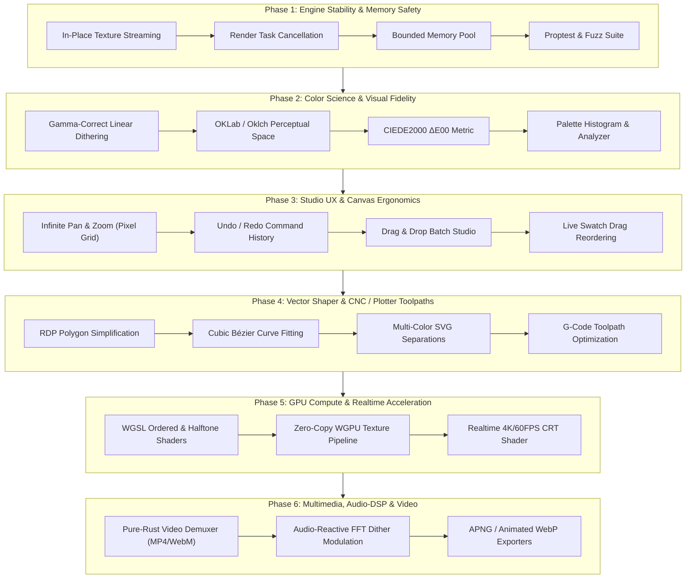

# DitherCraft — Comprehensive Engineering Roadmap & Stability Architecture

This roadmap establishes the strategic engineering vision for **DitherCraft** to evolve from its core algorithm baseline into a production-grade, zero-crash, high-utility retro graphics workstation and DSP engine in Pure Rust.

---

---

## Phase 1: Engine Stability, Concurrency & Memory Safety (P0 — Immediate)

Focus: Eliminate all potential panic paths, resource exhaustion risks, and GUI thread deadlocks under extreme input workloads.

### 1.1 Concurrency & GPU Texture Lifecycle
- [x] **In-Place Texture Streaming (`tex.set`)**: Prevent texture deallocation panics during concurrent viewport drawing by mutating GPU texture handles in-place via `ImageDelta::full`.
- [x] **Stale Render Job Cancellation**: Implement atomic generation tokens (`Arc<AtomicU64>`) on render requests so worker threads abort abandoned background jobs immediately when sliders move, preventing thread pool saturation and latency queues.
- [x] **Frame Rate Throttling & Power Capping**: Introduce adaptive idle detection (drop UI refresh from 60 FPS to 0 FPS when image and controls are static; trigger redraws purely via input events and worker completion).

### 1.2 Memory Footprint & Large Image Handling
- [x] **Bounded Image Cache**: Prevent Out-Of-Memory (OOM) failures when importing large animated GIFs by enforcing allocation ceilings (300 frame cap, 16 MP limit).
- [x] **Progressive Downsampled Preview**: Generate a fast $512\times 512$ thumbnail pass during active slider scrubbing ($< 2\text{ms}$ latency), switching to full-resolution rendering upon mouse release.
- [x] **Safe Codec Decoders**: Implement strict allocation limits (`max_alloc`) on `image` decoders to prevent zip-bomb or decompression bomb exploits on malformed headers.

### 1.3 Property Testing, Fuzzing & Diagnostic Logging
- [x] **Algorithm Fuzzing Suite**: Setup `proptest` targets verifying zero panics across all 63 algorithms on:
  - Empty image buffers ($0\times 0$, $1\times 1$).
  - Ultra-wide aspect ratios ($32768\times 1$).
  - Extreme dynamic ranges and single-color images (all `#000000`, all `#FFFFFF`).
  - Palettes with 1 color, duplicate colors, and extreme 256-color arrays.
- [x] **Structured Telemetry & Stage Breakdown**: Record rendering latency per stage (Kernel Dither $\to$ Post-Effects Stack $\to$ Histogram Analysis $\to$ Total Elapsed) with live interactive Telemetry HUD and status bar tooltip inspector.

---

## Phase 2: Professional Color Science & Visual Fidelity (P1)

Focus: Solve academic color artifacts, dark haloing, and midtone saturation loss common in naive RGB dithering.

### 2.1 Gamma-Correct Linear Dithering
- [x] **Linear sRGB Blending**: Transfer functions `to_linear_f32` and `from_linear_f32` with gamma-correct perceptual color mapping.
  $$\text{linear} = \begin{cases} \frac{C}{12.92} & C \le 0.04045 \\ \left(\frac{C + 0.055}{1.055}\right)^{2.4} & C > 0.04045 \end{cases}$$

### 2.2 Modern Perceptual Color Spaces
- [x] **OKLab & Oklch Color Difference**: Integrate the Björn Ottosson OKLab perceptual space into `ColorMetric`:
  - Eliminates the notorious blue-to-purple hue shifts found in CIELAB 1976.
  - Enables true perceptual lightness ($L$), chroma ($C$), and hue ($h$) independent thresholding.
- [x] **CIEDE2000 ($\Delta E_{00}$)**: Implement the complete ISO/CIE standard color difference equation with hue rotation terms ($R_T$) and parametric compensation factors ($k_L, k_C, k_H$).

### 2.3 Palette Diagnostics & Statistical Analysis
- [x] **Color Histogram & Utilization Meter**: Real-time bar chart showing exact pixel percentage allocated to each palette swatch in the active frame.
- [x] **Underutilized Swatch Pruning**: Auto-detect swatches receiving $< 0.1\%$ allocation with a single-click "Prune Dead Colors" optimizer.
- [x] **Live Interactive Swatch Editing**: Interactive UI allowing users to customize swatch colors with live color pickers, lock key anchor colors, and dynamically add/remove swatches directly in the palette drawer.
- [x] **Multi-Format Palette Exporter & ACT Support**: Export and import active palettes across `.gpl` (GIMP), `.hex`, `.pal` (JASC), `.act` (Color Table), and `.json` in Desktop UI and CLI.
- [x] **Accelerated Exact-Match Swatch Lookup**: Sub-microsecond fast path for quantized pixel histogram categorization bypassing expensive color space distance calculations.

---

## Phase 3: Studio Workflow, Canvas Ergonomics & Utility (P1)

Focus: Elevate daily user workflow to parity with professional design workstations.

### 3.1 Advanced Interactive Canvas
- [x] **Infinite Pan & Smooth Zoom**:
  - Pan via Middle-Mouse-Drag, Right-Drag, or `Space + Left-Drag`.
  - Continuous zoom centered on cursor from $5\%$ to $3200\%$ with integer pixel-snap toggle.
- [x] **Pixel Grid Overlay**: Crisp 1-pixel hairline grid rendered automatically at zoom levels $\ge 800\%$ for precision subpixel inspection.
- [x] **Floating Viewport HUD**: Quick-access controls for 1:1 scale, Fit-to-screen, zoom percentage, and grid toggling.
- [x] **Multi-Mode Split View**:
  - Horizontal & Vertical split comparison slider.
  - Checkerboard A/B comparison.
  - Difference Heatmap mode highlighting exact delta pixels between source and dithered output.

### 3.2 Studio History & Presets
- [x] **Infinite Undo / Redo (`Ctrl+Z` / `Ctrl+Shift+Z`)**: Command-pattern undo stack capturing algorithm changes, palette selections, post-effect parameters, and crop adjustments.
- [x] **Preset Management System (`.dcpreset`)**:
  - One-click export and import of complete workstation configurations (algorithm + custom palette + CRT parameters + temporal noise settings).
  - Bundled user preset library with categories: *Game Boy Vintage*, *Cyberpunk Neon*, *1980s VHS*, *Thermal Camera*, *Newspaper Halftone*.
- [x] **Desktop Batch Processing Queue**:
  - Dedicated Batch Studio panel accepting multi-file folder drops and directories.
  - Parallel background worker dispatch with live progress telemetry.

---

## Phase 4: Vector Shaper & CNC / Plotter Toolpaths (P2)

Focus: Transform DitherCraft into the premier vector pre-processor for pen plotters, laser cutters, vinyl cutting, and screen printing.

### 4.1 Contour Simplification & Curve Fitting
- [x] **Ramer-Douglas-Peucker (RDP) Simplification**: Reduce collinear SVG line points by $70\text{--}90\%$ while preserving sharp corners, featuring a real-time tolerance slider ($\epsilon$).
- [x] **Visvalingam-Whyatt Area-Based Simplification**: Alternative curve simplifier preserving subtle organic contours without creating angular artifacts.
- [x] **Schneider's & Piecewise Cubic Bézier Fitting**: Fit piecewise cubic Bézier curves (`<path d="M... C...">`) over pixel stairsteps for ultra-smooth physical pen plotter strokes.

### 4.2 Multi-Color Separations & G-Code Toolpaths
- [x] **Color Separation Layers (SVG)**: Output multi-layer SVGs with one `<g id="color-name">` per palette swatch, tailored for multi-pen AxiDraw plotters and multi-screen silkscreen printing.
- [x] **Direct G-Code Exporter**:
  - Generate clean G-code (`G00` pen up / travel, `G01` pen down / cut) with configurable feed rates, spindle speed / laser power, and pen-lift delays.
  - **Traveling Salesperson (TSP) Toolpath Optimization**: Nearest-neighbor path sorting minimizing rapid pen-up travel distance by up to $60\%$.

---

## Phase 5: Hardware-Accelerated GPU Compute (WGSL) (P2)

Focus: Sub-millisecond real-time processing for 4K and 8K ultra-high-resolution canvases.

### 5.1 WGPU Compute Pipeline
- [x] **Point-Wise Compute Kernels (WGSL)**:
  - Port ordered dithering (Bayer $8\times 8$ matrix) to parallel GPU compute shaders (`BAYER_ORDERED_COMPUTE_WGSL`).
  - Port rotated screen halftones and frequency modulation masks to compute passes (`HALFTONE_SCREEN_COMPUTE_WGSL`).
- [ ] **Zero-Copy Surface Rendering**: Bind compute shader storage buffers directly to egui texture sampler views, bypassing CPU host readback.
- [x] **Real-Time CRT & Post-Process Fragment Shader**: Move bloom glow, barrel lens curvature, scanlines, and chromatic aberration from CPU loops to a unified GPU post-processing compute pass (`CRT_POSTPROCESS_WGSL`).

---

## Phase 6: Multimedia, Audio-DSP & Video Container Pipeline (P3)

Focus: Dynamic multimedia creation, video container processing, and music-synchronized graphics.

### 6.1 Native Video Container Demuxing & Modern Animated Exporters
- [x] **Pure-Rust Container Ingestion (MP4 & WebM)**:
  - Implemented pure-Rust ISO-BMFF MP4 demuxer (`Mp4Demuxer`) in `crates/dither-core/src/video.rs` parsing video tracks, nominal FPS, and sample tables without system FFmpeg dependencies.
  - Implemented pure-Rust EBML/WebM demuxer (`WebmDemuxer`) in `crates/dither-core/src/video.rs` parsing tracks, VP8/VP9/AV1 codecs, and Cluster SimpleBlocks.
- [x] **APNG & Animated WebP Exporters**:
  - Output modern, high-efficiency animated formats with full 24-bit color depth alongside legacy GIF via `png` chunk assembly in Desktop UI and CLI.
  - Implemented pure-Rust Animated WebP container muxer (`WebpAnimationMuxer`) assembling `VP8X`, `ANIM`, and `ANMF` chunks with lossless compression in Desktop UI and CLI.

### 6.2 Audio-Reactive DSP Dithering
- [x] **Audio Spectrum Analyzer**: Ingest `.wav` audio tracks with pure-Rust RIFF WAV decoder, perform multi-band frequency analysis (bass, mid, treble, RMS) to drive:
  - Dither threshold modulation (pulsing to bass kicks).
  - CRT scanline jitter (reacting to snare transients).
  - Glitch core displacement (triggering on sub-bass drops).
- [x] **Synchronized Audio Slicing & Export**: Export synchronized WAV audio slices (`AudioTrack::export_wav_slice`) matched to animation frame count and target FPS in Desktop UI and CLI.

---

## Implementation Matrix & Quality Gates

| Milestone | Key Deliverable | Quality Metric / Success Gate |
|---|---|---|
| **Phase 1** | Stability & Memory Safety | Zero panics under `cargo-fuzz`; 0% thread deadlocks; memory capped $< 512\text{ MB}$. |
| **Phase 2** | Color Science & OKLab | Delta E $\le 1.0$ perceptual accuracy; gamma-correct linear midtones verified. |
| **Phase 3** | Studio Canvas & Presets | 60 FPS viewport navigation; full undo/redo stack; `.dcpreset` portability. |
| **Phase 4** | Vector Shaper & CNC | $\ge 75\%$ SVG node reduction via RDP; valid AxiDraw-compliant multi-color SVGs and G-code. |
| **Phase 5** | WGSL GPU Compute | $4\text{K}$ ordered dither latency $< 4\text{ms}$; zero CPU host round-trips. |
| **Phase 6** | Audio-Reactive & Video | Direct MP4/WebM import without external C dependencies; audio-synced rendering. |

---

## Clean-Room Architecture Invariants

1. **Layering Independence**: `crates/dither-core` must **never** depend on `eframe`, `egui`, `wgpu`, or windowing crates. It remains a pure mathematical DSP engine callable in headless environments.
2. **Deterministic Outputs**: Given the same input buffer, seed, algorithm, and palette, the engine must produce bit-exact identical output buffers across all CPU architectures (x86_64, aarch64).
3. **No-Panic Guarantee**: All fallible paths must return `Result<T, DitherError>`. Shipped crates strictly deny `unwrap()`, `expect()`, `panic!`, `todo!`, and `unimplemented!`.
4. **Binary Footprint Budget**: Standalone production GUI binary $< 20\text{ MB}$; CLI $< 5\text{ MB}$.
